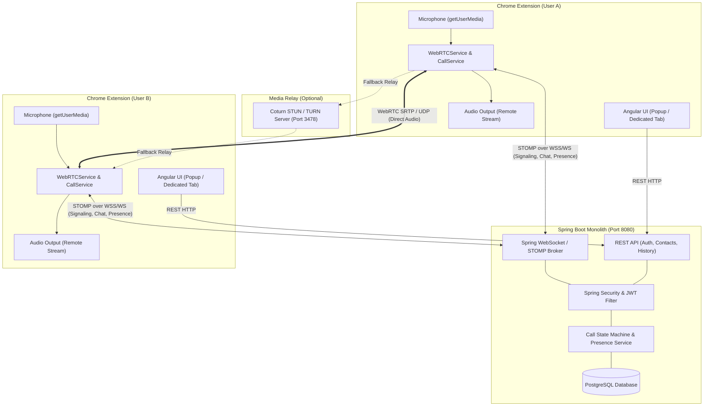

# VoiceLink — System Architecture & Design

## 1. Overview & Vision

**VoiceLink** is a Chrome Browser Extension (Manifest V3) providing lightweight, direct voice calling and real-time private chat.

The foundational design principle is **strict separation between signaling and media**:
- **Backend (Spring Boot)** handles identity, contacts, presence, call state coordination, and WebRTC signaling relay. **The backend NEVER carries, buffers, or analyzes media streams.**
- **Clients (Chrome Extensions)** capture local microphone audio (`getUserMedia`), negotiate peer connections via WebRTC (`RTCPeerConnection`), and transmit audio streams peer-to-peer (or via TURN relay when NAT prevents direct P2P).

---

## 2. High-Level Architecture Diagram



---

## 3. Monorepo Structure

```
voicelink/
  ├── backend/               # Spring Boot 3.3.x (Java 21) REST & WebSocket Server
  │   ├── src/main/java/     # Business modules (auth, users, contacts, calls, chat, signaling)
  │   ├── src/main/resources/# application.yml, Flyway SQL migrations
  │   └── src/test/java/     # Unit and slice test suites
  ├── frontend/              # Angular 17.3+ (TypeScript, Standalone components)
  │   ├── src/app/core/      # Services (WebRTC, WebSocket, Call, Chat, Auth, Presence)
  │   ├── src/app/features/  # Standalone views (auth, contacts, chat, calls, settings)
  │   └── src/manifest.json  # Chrome Extension Manifest V3 configuration
  ├── infrastructure/        # Coturn TURN/STUN configuration
  ├── scripts/               # PowerShell and Bash automated build/run scripts
  ├── docs/                  # Architecture, Signaling, State Machine, Security, Deployment
  ├── docker-compose.yml     # Complete local stack (PostgreSQL, Backend, Coturn)
  └── README.md              # Quickstart and execution guide
```

---

## 4. Component Responsibilities

### 4.1 Frontend (Angular Standalone + Chrome Extension)
- Render responsive dark-mode UI designed for both Chrome Popup (400px width) and dedicated popup windows.
- Authenticate against REST API and maintain JWT in Chrome extension storage.
- Request microphone permission only when initiating or accepting calls (`navigator.mediaDevices.getUserMedia`).
- Maintain peer connections (`RTCPeerConnection`), collect ICE candidates, apply remote SDP descriptions.
- Synthesize audio chimes using the HTML5 Web Audio API (zero external asset dependency).
- Stream remote audio to HTML `<audio>` elements with autoplay protection handling.
- Provide microphone mute/unmute toggle (`MediaStreamTrack.enabled`).
- Exchange real-time chat messages and render conversations.

### 4.2 Backend (Spring Boot 3.3)
- Authenticate HTTP requests via JWT Filter and WebSocket STOMP handshakes via Channel Interceptor.
- Maintain unique normalized usernames (`^[a-zA-Z0-9_]{3,30}$`).
- Maintain real-time presence (online/offline) with multi-session awareness.
- Enforce call state machine rules (single active call per user, timeout expiration, authorization).
- Forward WebRTC signaling (Offer, Answer, ICE Candidates) **strictly** to authorized call participants.
- Persist contact relationships, messages, and call histories.
- Never accept or touch audio media packets.
