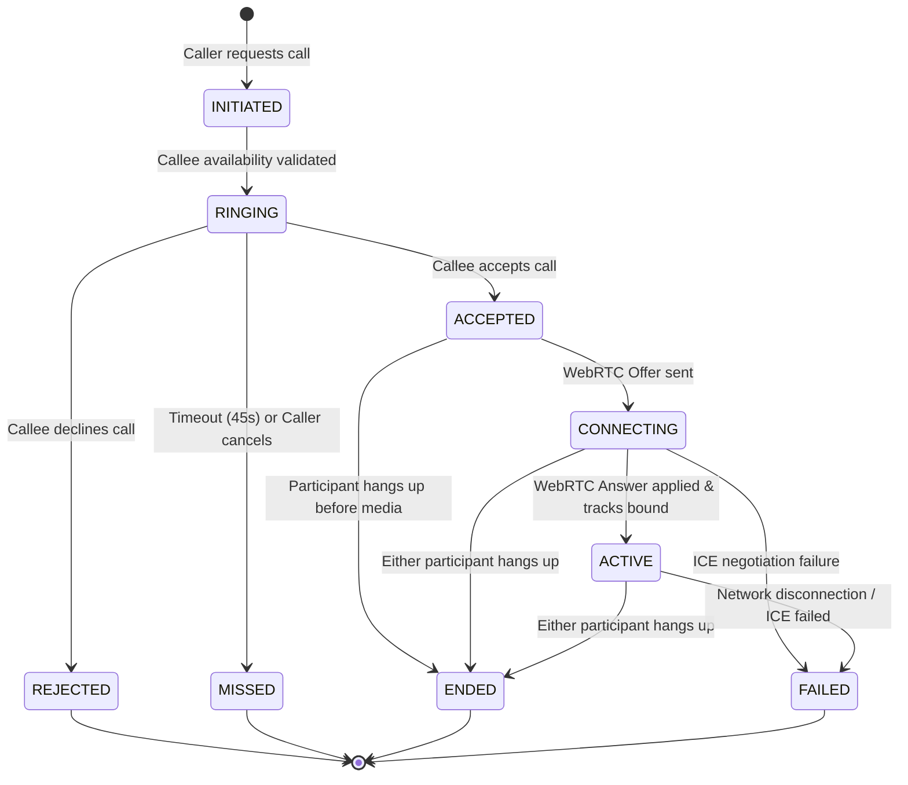

# VoiceLink — Call State Machine Specification

## 1. Overview

To guarantee deterministic, reliable call handling and prevent race conditions, orphan connections, or inconsistent states across distributed clients, VoiceLink enforces an explicit, centralized state machine on the backend.

---

## 2. State Diagram

---

## 3. State Definitions & Transitions

| State | Description | Valid Transitions To | Trigger / Conditions |
|---|---|---|---|
| `INITIATED` | Call created in database, verifying callee online status | `RINGING`, `FAILED` | System verification |
| `RINGING` | Callee notified via STOMP, ringtone playing | `ACCEPTED`, `REJECTED`, `MISSED` | Callee action, cancel, or 45s timer |
| `ACCEPTED` | Callee pressed Accept, both clients start WebRTC setup | `CONNECTING`, `ENDED`, `FAILED` | WebRTC negotiation start |
| `CONNECTING` | SDP Offer received, negotiating ICE paths and codecs | `ACTIVE`, `FAILED`, `ENDED` | SDP Answer exchanged |
| `ACTIVE` | Two-way audio flowing through WebRTC peer connection | `ENDED`, `FAILED` | Normal hangup or network failure |
| `REJECTED` | Callee declined incoming call | Terminal | Callee pressed Decline |
| `MISSED` | Call timed out (45s without answer) or cancelled by caller | Terminal | System timer or caller cancellation |
| `ENDED` | Call successfully completed and terminated | Terminal | Either participant clicked Hang Up |
| `FAILED` | WebRTC ICE failed or media stream lost | Terminal | Network failure or device error |

---

## 4. Mandatory Business Rules

1. **Single Call Invariant**: A user may only participate in at most one active or pending call at any time (`findActiveCallForUser`). Attempting to initiate or receive another call returns `409 Conflict`.
2. **Self-Call Prohibition**: Calling one's own username is rejected (`400 Bad Request`).
3. **Callee Authorization**: Only the designated callee can transition a call from `RINGING` to `ACCEPTED` or `REJECTED`.
4. **Participant Only Hangup**: Only the caller or callee can transition a call to `ENDED`. Third parties cannot interfere.
5. **Scheduled Timeout Cleanup**: A background task (`@Scheduled(fixedRate = 5000)`) queries calls in `RINGING` created more than 45 seconds ago, transitions them to `MISSED`, and pushes `CALL_TIMEOUT` events to both parties.
6. **Duration Calculation**: Upon entering `ENDED`, call duration is computed as `Duration.between(acceptedAt, endedAt).getSeconds()`.
