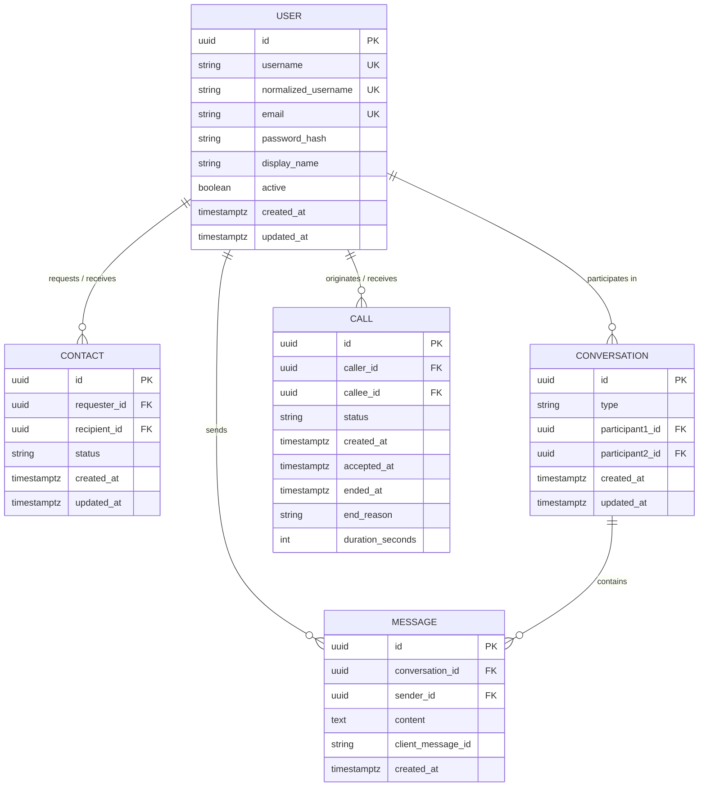

# VoiceLink — Relational Data Model

## 1. Entity-Relationship Diagram

---

## 2. Table Specifications & Indexes

### 2.1 `users` Table
- `id` (UUID, Primary Key)
- `username` (VARCHAR(50), Unique, Not Null)
- `normalized_username` (VARCHAR(50), Unique, Not Null, Index: `idx_users_normalized_username`) — Used for case-insensitive lookup.
- `email` (VARCHAR(255), Unique, Not Null, Index: `idx_users_email`)
- `password_hash` (VARCHAR(255), Not Null) — BCrypt hash (strength 12).
- `display_name` (VARCHAR(100), Not Null)
- `active` (BOOLEAN, Default: TRUE)

### 2.2 `contacts` Table
- `id` (UUID, Primary Key)
- `requester_id` (UUID, FK $\to$ users, Index: `idx_contacts_requester`)
- `recipient_id` (UUID, FK $\to$ users, Index: `idx_contacts_recipient`)
- `status` (VARCHAR(20), PENDING / ACCEPTED / REJECTED / BLOCKED)
- Unique Constraint: `uq_contact_pair (requester_id, recipient_id)`

### 2.3 `conversations` Table
- `id` (UUID, Primary Key)
- `type` (VARCHAR(20), Default: 'DIRECT')
- `participant1_id` (UUID, FK $\to$ users, Index: `idx_conversations_p1`)
- `participant2_id` (UUID, FK $\to$ users, Index: `idx_conversations_p2`)
- Unique Constraint: `uq_conversation_participants (participant1_id, participant2_id)` (Normalized with lower UUID first to prevent inverted duplicate conversations).

### 2.4 `messages` Table
- `id` (UUID, Primary Key)
- `conversation_id` (UUID, FK $\to$ conversations)
- `sender_id` (UUID, FK $\to$ users)
- `content` (TEXT, Not Null, max length enforced at 2000 characters)
- `client_message_id` (VARCHAR(100)) — Used for client-side idempotent deduplication.
- Index: `idx_messages_conversation_date (conversation_id, created_at DESC)` for efficient paginated retrieval.

### 2.5 `calls` Table
- `id` (UUID, Primary Key)
- `caller_id` (UUID, FK $\to$ users, Index: `idx_calls_caller`)
- `callee_id` (UUID, FK $\to$ users, Index: `idx_calls_callee`)
- `status` (VARCHAR(30), Not Null)
- `created_at` (TIMESTAMPTZ, Not Null)
- `accepted_at` (TIMESTAMPTZ)
- `ended_at` (TIMESTAMPTZ)
- `end_reason` (VARCHAR(50))
- `duration_seconds` (INT, Default: 0)

> **No Audio Storage**: Neither audio streams nor voice recordings are ever persisted in the database.
